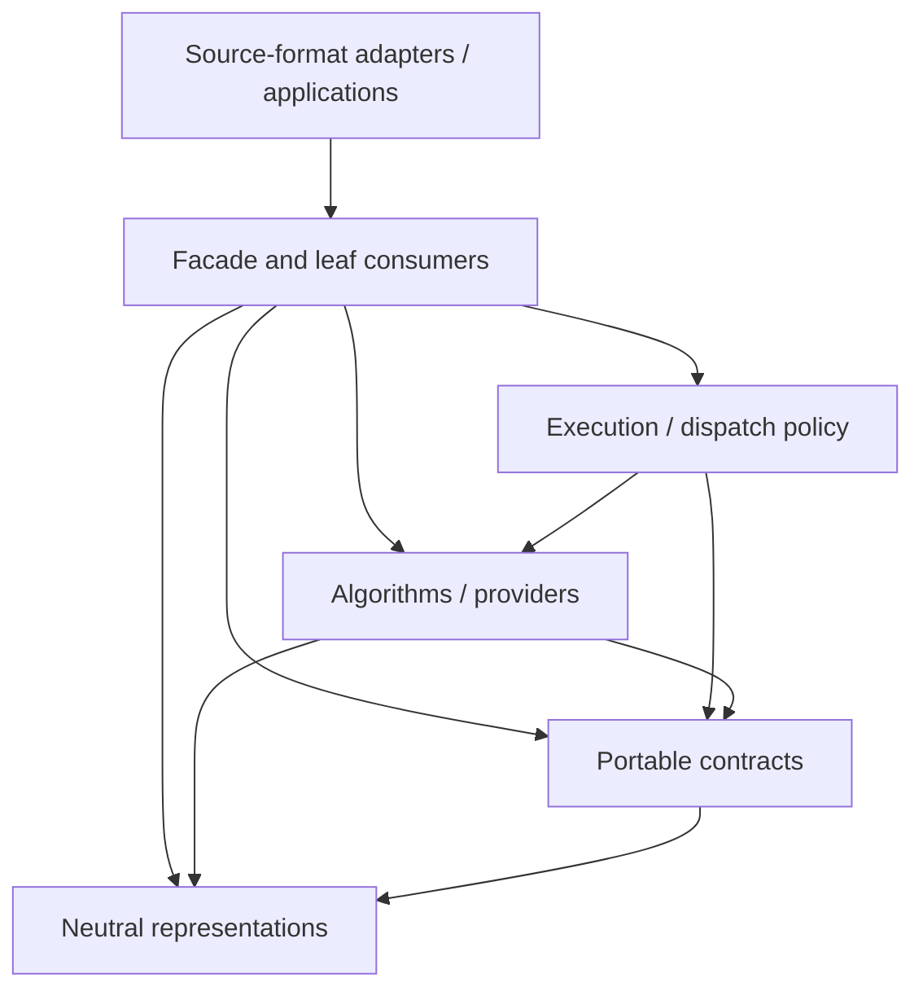

# Architecture

Axiolid separates **representations**, **portable operation contracts**, **algorithms/providers**, **execution policy**, and the **facade**. Cargo packages mark real dependency, trust, compilation, provider, licensing, and conformance boundaries; conceptual taxonomy does not force a crate per noun.

## Dependency direction

Arrows point from a consumer to a role it may depend on; they are not runtime
data-flow arrows.

The executable role DAG is checked by `cargo xtask architecture check`. Every workspace package declares its layer, role, domain, format neutrality, and exact internal-dependency allowlist. Production/build edges must point downward; explicit dev-only upward edges are allowed solely for integration and conformance tests.

Key rules:

- Representation packages contain format-neutral values and cannot depend on algorithms, providers, execution, or source-format packages.
- `axiolid-guarantees` owns proof/refusal vocabulary; `axiolid-contracts` owns common backend, execution, and diagnostics vocabulary.
- Each operation contract owns typed inputs, results, evidence, refusals, and conformance behavior. It does not select providers.
- `axiolid-dispatch` owns provider registration, ordering, device matching, fallback, and budget admission.
- Execution plans are internal runtime policy, never portable capability schemas.
- Source-format interpretation remains in external adapters such as `openbimrs/ifc`'s `ifc-geometry` crate.

See the generated [crate map](/architecture/crate-map), [dependency graph](/architecture/dependency-graph), and [ADR 0035](/adr/0035-nested-ownership-and-capability-contracts).

## Neutral geometry DAG

`axiolid-model` stores shared geometry in an immutable append-only graph. Typed IDs refer only backward, so cyclic construction is rejected before evaluation. The graph captures neutral authored intent; it is not a source-format AST and does not imply every represented family has an evaluator.

## Result-domain honesty

Exact B-rep values live in `axiolid-brep`. Triangle output is requested through `axiolid-mesh-compile-contract::MeshCompiler`; the API and method names explicitly say mesh. Tessellation remains a tolerance-bearing projection contract in `axiolid-tessellation-contract`. No generic “geometry compiler” silently collapses exact and discrete result domains.

## Contracts, providers, and execution

Portable seams are split by operation:

- `axiolid-mesh-boolean-contract`;
- `axiolid-mesh-section-contract`;
- `axiolid-mesh-hidden-lines-contract`;
- `axiolid-mesh-compile-contract`;
- `axiolid-tessellation-contract`.

Implementations remain independently replaceable:

- `axiolid-reference` is readable portable reference work and the scalar oracle;
- `axiolid-mesh-boolean-boolmesh` is an isolated mesh-Boolean provider;
- `axiolid-backend-cpu` and `axiolid-backend-gpu` are execution contexts/adapters;
- `axiolid-mesh-compile` is the reference graph-to-mesh execution pipeline.

## Tolerance and numerical work

Tolerance is explicit operation input rather than an ambient global epsilon. Numerically sensitive predicates are owned by the reference layer, with typed certification/escalation where implemented. An optimized path must be supported by differential tests and benchmarks, not merely an architecture claim.
